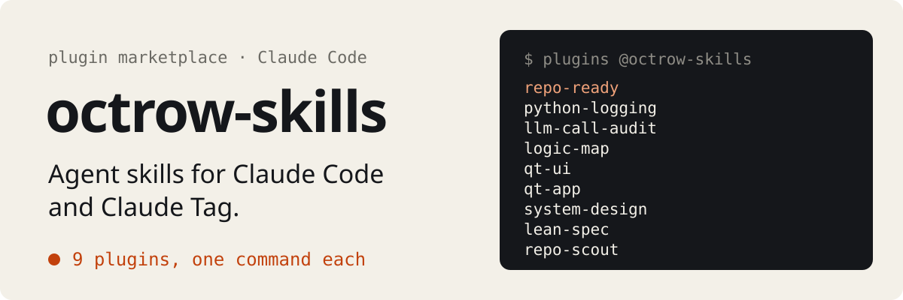

<p align="center">
  
</p>

<p align="center"><b>English</b> | <a href="README.ru.md">Русский</a></p>

<p align="center"><a href="https://scorecard.dev/viewer/?uri=github.com/octrow/octrow-skills"></a></p>

Agent skills for Claude Code and Claude Tag, in one plugin marketplace.

Add the marketplace once, then install the plugins you want:

```bash
claude plugin marketplace add octrow/octrow-skills
claude plugin install repo-ready@octrow-skills
```

## Plugins

| Plugin | What it does | Install |
|---|---|---|
| [repo-ready](plugins/repo-ready/README.md) | four skills that publish, deploy, clean up and secure a project | `claude plugin install repo-ready@octrow-skills` |
| [python-logging](plugins/python-logging/README.md) | sets up and fixes logging in a Python project | `claude plugin install python-logging@octrow-skills` |
| [llm-call-audit](plugins/llm-call-audit/README.md) | finds the cheapest option for every model call | `claude plugin install llm-call-audit@octrow-skills` |
| [logic-map](plugins/logic-map/README.md) | writes `docs/logic-map.md`, the file an agent reads first | `claude plugin install logic-map@octrow-skills` |
| [qt-ui](plugins/qt-ui/README.md) | fixes visual defects in a PySide6 / PyQt6 app | `claude plugin install qt-ui@octrow-skills` |
| [qt-app](plugins/qt-app/README.md) | builds a PySide6 GUI for a Python project | `claude plugin install qt-app@octrow-skills` |
| [system-design](plugins/system-design/README.md) | designs a backend from numbers | `claude plugin install system-design@octrow-skills` |
| [lean-spec](plugins/lean-spec/README.md) | checks logic against a Lean 4 model | `claude plugin install lean-spec@octrow-skills` |
| [repo-scout](https://github.com/octrow/repo-scout) | finds GitHub repos to build on before you write your own | `claude plugin install repo-scout@octrow-skills` |

repo-scout drives the repo-scout CLI. Install that first: one command, see its README.

Each plugin page has what it does, the `npx skills` command and example requests.

## Other agents and setups

Codex, Cursor, Gemini CLI and more, via [skills](https://github.com/vercel-labs/skills):

```bash
npx skills add octrow/octrow-skills --skill repo-publish -g
```

Use any skill name from the plugin pages instead of `repo-publish`.

On Windows, run `git config --global core.symlinks true` first. Each skill links in the shared `engine/` folder, and Git for Windows checks symlinks out as plain text files by default.

From a local clone: `claude plugin marketplace add ./octrow-skills`.

Claude Tag: an admin registers this repository under Organization settings → Plugins & skills → Sync from GitHub, then adds the plugin to a bundle.

## repo-ready

repo-ready has four skills: `repo-publish`, `repo-deploy`, `repo-code-health` and `repo-secure`. They start with the same read-only preflight. It lists the gaps as named Checks with a severity and a pointer to the fix. The skill then fixes only the parts you pick.

| Skill | Use it when | What it looks at |
|---|---|---|
| `repo-publish` | a repo is about to go public | history and secrets, install, README, CI, SEO, release |
| `repo-deploy` | a service should run as containers | Dockerfile, health endpoints, Compose, image publishing, Helm, metrics |
| `repo-code-health` | Python code is harder to change than it should be | ruff, complexity, dead code, CI for lint, tests and types |
| `repo-secure` | an app is live or about to be | authorization, trusted client input, rate limits, supply chain, logging, secrets, backups |

The preflight on a test repo:


Then ask in a project: "prepare this repo for publishing", "is my app secure?", "put it in Docker". Requests in Russian work too.

Phases of repo-publish, the preflight output, the ready-made workflow files and the other three skills: [plugins/repo-ready/README.md](plugins/repo-ready/README.md).

## How repo-publish differs from similar skills

- [github-repo](https://github.com/jdevalk/skills) audits and writes the README, community health files, templates and metadata. repo-publish calls it for that part and adds what comes before and after: history and secrets, provenance, install path, CI hardening, release and launch.
- [beautify-github-readme](https://github.com/oil-oil/beautify-github-readme) redesigns the README's visual story (hero, proof images, SVG). repo-ready ships a fork of it that also cuts the README to a length budget and lints the wording; the preflight runs that lint.
- [github-morestar-skill](https://github.com/everest-an/github-morestar-skill) focuses on growth: positioning and a launch day across channels. repo-publish plans a launch too, but only after the repo is safe to publish and installs on a clean machine.

## Repository layout

This repo is a plugin marketplace. repo-ready, python-logging, llm-call-audit, logic-map, qt-ui, qt-app, system-design and lean-spec live here. repo-scout lives in its own repo, and the marketplace entry points there.

```
.claude-plugin/marketplace.json     list of plugins
plugins/<name>/.claude-plugin/      plugin manifest
plugins/<name>/skills/<skill>/      SKILL.md of one Scenario, plus the `engine/` link
plugins/repo-ready/engine/          preflight, Check catalog, procedures/ and assets/ shared by the Scenarios
tests/                              preflight tests (stdlib unittest)
evals/<skill>.json                  test prompts and assertions used to tune each skill
```

Check before a commit: `claude plugin validate .` and `python3 -m unittest discover tests`.

Changes per version: [CHANGELOG.md](CHANGELOG.md). How to contribute: [CONTRIBUTING.md](CONTRIBUTING.md). Security reports: [SECURITY.md](SECURITY.md).

## License

MIT
