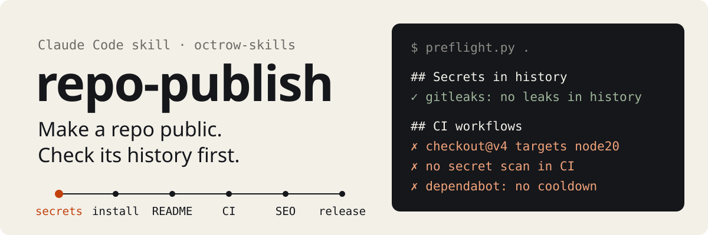

<p align="center">
  
</p>

<p align="center"><b>English</b> | <a href="README.ru.md">Русский</a></p>

<p align="center"><a href="https://scorecard.dev/viewer/?uri=github.com/octrow/octrow-skills"></a></p>

repo-publish is a skill for Claude Code and Claude Tag that takes a working project to a public GitHub repo a
stranger can find, trust and install. It reads the repo and its history before anything goes public, then does the
publishing work in a safe order and hands parts to other skills when they're installed.

## Install

Claude Code:

```bash
claude plugin marketplace add octrow/octrow-skills
claude plugin install repo-publish@octrow-skills
```

Other agents (Codex, Cursor, Gemini CLI and more) via [skills](https://github.com/vercel-labs/skills):

```bash
npx skills add octrow/octrow-skills --skill repo-publish -g
```

From a local clone: `claude plugin marketplace add ./octrow-skills`.

The same marketplace has [repo-scout](https://github.com/octrow/repo-scout), a skill that finds GitHub repos to
build on before you write your own: `claude plugin install repo-scout@octrow-skills`. It drives the repo-scout CLI,
so install that first (one command, see its README).

Claude Tag: an admin registers this repository under Organization settings → Plugins & skills → Sync from GitHub,
then adds the plugin to a bundle.

Then ask in a project: "prepare this repo for publishing", "what's missing before I open-source this?", or just one
part: "add a Russian README", "refresh the screenshots".

## What the preflight finds

The first step changes nothing: it reads the repo, its history and its GitHub settings. An excerpt from a run on a
test repo:

```text
## .gitignore
- not ignored: .env, .env.local, .venv/x, dist/x.whl, x.egg-info/PKG-INFO
- append the template: gh api gitignore/templates/Python --jq .source >> .gitignore

## CI workflows
- ci.yml: no top-level `permissions:` (default token may be read-write)
- third-party actions pinned by tag, not SHA: softprops/action-gh-release@v2 (zizmor flags these)
- actions/checkout@v4: targets node20, deprecated (forced onto Node 24 with a warning); bump the major
- dependabot.yml: no `cooldown` (wait ~7 days before proposing a release; assets/dependabot.yml)
```

It also checks secrets in the whole history (gitleaks), private paths, employer names and author emails, code
provenance, whether the package name is free on PyPI/npm, broken README links, SKILL.md frontmatter that agents
can't load, failing Dependabot PRs, and the repo's description, topics, social preview, branch protection, secret
scanning and private vulnerability reporting.

## How it works

After the preflight and a few questions (audience, right to publish, visibility, languages), the skill works
through the phases you pick, in this order:

1. Security and history: secrets in history get rotated first, private material gets a fresh-history export,
   and the repo gets pre-commit and CI scanning so it stays clean.
2. Install: one command to install and one to run, with the installers tested in CI on Linux, macOS and Windows,
   and releases built for all three (wheel, optional standalone binaries). The package name is checked before the README tells anyone to `pipx install` it.
3. README and docs: structure via `github-repo`, visuals via `beautify-github-readme`, plain language via
   `humanizer`, EN/RU mirrors kept in sync.
4. GUI, if there is one: before/after screenshots, then refreshed README shots.
5. Community files and CI: SECURITY, CONTRIBUTING, issue forms and the workflow templates below.
6. Discoverability: description, topics, social preview, the README's first 200 words.
7. Release: version, changelog, tag, and trusted publishing to PyPI.
8. Launch, only on request: a readiness check and drafts per channel; you post them.

Anything other people can see (push, tag, release, visibility, GitHub settings, posts) waits for your yes.

The fixes come as ready files in [`assets/`](plugins/repo-publish/skills/repo-publish/assets): a pre-commit config
(gitleaks, zizmor, actionlint), a security workflow (gitleaks over the whole history), OpenSSF Scorecard,
`install.sh`/`install.ps1` installers with a CI check on three OSes, a release workflow (wheel, binaries for
Linux/macOS/Windows, PyPI via trusted publishing, build provenance), and Dependabot with a cooldown. Actions are pinned to commit
SHAs, and every file passes zizmor and actionlint. [repo-scout](https://github.com/octrow/repo-scout) uses all of
them, filled in for a real Python app.

## How it differs from similar skills

- [github-repo](https://github.com/jdevalk/skills) audits and writes the README, community health files,
  templates and metadata. repo-publish calls it for that part and adds what comes before and after: history and
  secrets, provenance, install path, CI hardening, release and launch.
- [beautify-github-readme](https://github.com/oil-oil/beautify-github-readme) redesigns the README's visual
  story (hero, proof images, SVG). repo-publish uses it in the README phase.
- [github-morestar-skill](https://github.com/everest-an/github-morestar-skill) focuses on growth: positioning
  and a launch day across channels. repo-publish plans a launch too, but only after the repo is safe to publish
  and installs on a clean machine.

## Repository layout

This repo is a plugin marketplace. repo-publish lives here; repo-scout lives in its own repo, and the marketplace
entry points there.

```
.claude-plugin/marketplace.json     list of plugins
plugins/<name>/.claude-plugin/      plugin manifest
plugins/<name>/skills/<name>/       SKILL.md, references/, scripts/, assets/
evals/<name>.json                   test prompts and assertions used to tune each skill
```

Check before a commit: `claude plugin validate .` Changes per version: [CHANGELOG.md](CHANGELOG.md). How to
contribute: [CONTRIBUTING.md](CONTRIBUTING.md). Security reports: [SECURITY.md](SECURITY.md).

## License

MIT
