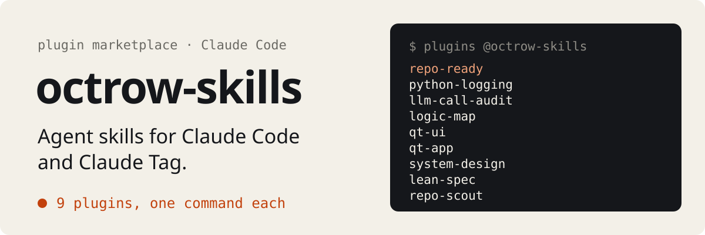

<p align="center">
  
</p>

<p align="center"><a href="README.md">English</a> | <b>Русский</b></p>

<p align="center"><a href="https://scorecard.dev/viewer/?uri=github.com/octrow/octrow-skills"></a></p>

Скиллы для Claude Code и Claude Tag в одном маркетплейсе плагинов.

Добавьте маркетплейс один раз, потом ставьте нужные плагины:

```bash
claude plugin marketplace add octrow/octrow-skills
claude plugin install repo-ready@octrow-skills
```

## Плагины

| Плагин | Что делает | Установка |
|---|---|---|
| [repo-ready](plugins/repo-ready/README.ru.md) | четыре скилла: публикация, деплой, чистка и защита проекта | `claude plugin install repo-ready@octrow-skills` |
| [python-logging](plugins/python-logging/README.ru.md) | настраивает и чинит логирование в Python-проекте | `claude plugin install python-logging@octrow-skills` |
| [llm-call-audit](plugins/llm-call-audit/README.ru.md) | ищет самый дешёвый вариант для каждого вызова модели | `claude plugin install llm-call-audit@octrow-skills` |
| [logic-map](plugins/logic-map/README.ru.md) | пишет `docs/logic-map.md`, файл, который агент читает первым | `claude plugin install logic-map@octrow-skills` |
| [qt-ui](plugins/qt-ui/README.ru.md) | правит визуальные дефекты в приложении на PySide6 / PyQt6 | `claude plugin install qt-ui@octrow-skills` |
| [qt-app](plugins/qt-app/README.ru.md) | строит GUI на PySide6 для Python-проекта | `claude plugin install qt-app@octrow-skills` |
| [system-design](plugins/system-design/README.ru.md) | проектирует бэкенд по цифрам | `claude plugin install system-design@octrow-skills` |
| [lean-spec](plugins/lean-spec/README.ru.md) | проверяет логику по модели на Lean 4 | `claude plugin install lean-spec@octrow-skills` |
| [repo-scout](https://github.com/octrow/repo-scout) | ищет на GitHub готовые репозитории, прежде чем писать своё | `claude plugin install repo-scout@octrow-skills` |

repo-scout работает через CLI repo-scout. Сначала поставьте его: одна команда, см. его README.

На странице плагина: что он делает, команда `npx skills` и примеры запросов.

## Другие агенты и способы установки

Codex, Cursor, Gemini CLI и другие, через [skills](https://github.com/vercel-labs/skills):

```bash
npx skills add octrow/octrow-skills --skill repo-publish -g
```

Вместо `repo-publish` подставьте имя любого скилла со страниц плагинов.

На Windows сначала выполните `git config --global core.symlinks true`. Каждый скилл подключает общую папку `engine/` символической ссылкой, а Git for Windows по умолчанию превращает ссылки в обычные текстовые файлы.

Из локального клона: `claude plugin marketplace add ./octrow-skills`.

Claude Tag: администратор подключает этот репозиторий в Organization settings → Plugins & skills → Sync from GitHub и добавляет плагин в bundle.

## repo-ready

В repo-ready четыре скилла: `repo-publish`, `repo-deploy`, `repo-code-health` и `repo-secure`. Они начинают с одного и того же preflight, который ничего не меняет. Он перечисляет пробелы как именованные проверки с уровнем серьёзности и ссылкой на исправление. Потом скилл исправляет только выбранные вами части.

| Скилл | Когда нужен | Что смотрит |
|---|---|---|
| `repo-publish` | репозиторий скоро станет публичным | история и секреты, установка, README, CI, SEO, релиз |
| `repo-deploy` | сервис должен работать в контейнерах | Dockerfile, health-эндпоинты, Compose, публикация образа, Helm, метрики |
| `repo-code-health` | Python-код менять труднее, чем должно быть | ruff, сложность, мёртвый код, линтер, тесты и типы в CI |
| `repo-secure` | приложение уже работает или вот-вот выйдет | авторизация, доверие к клиенту, rate limit, зависимости, логи, секреты, бэкапы |

Preflight на тестовом репо:


Потом в проекте можно попросить: «подготовь репо к публикации», «проверь безопасность приложения», «заверни в Docker». Просьбы на английском тоже работают.

Фазы repo-publish, вывод preflight, готовые файлы workflow и остальные три скилла: [plugins/repo-ready/README.ru.md](plugins/repo-ready/README.ru.md).

## Чем repo-publish отличается от похожих скиллов

- [github-repo](https://github.com/jdevalk/skills) проверяет и пишет README, файлы для сообщества, шаблоны и метаданные. repo-publish вызывает его для этой части и добавляет то, что до и после: историю и секреты, происхождение кода, установку, защиту CI, релиз и запуск.
- [beautify-github-readme](https://github.com/oil-oil/beautify-github-readme) перерабатывает визуальную часть README (hero, картинки-доказательства, SVG). В repo-ready лежит его форк: он ещё сокращает README до бюджета длины и проверяет формулировки, а preflight запускает эту проверку.
- [github-morestar-skill](https://github.com/everest-an/github-morestar-skill) про рост: позиционирование и день запуска сразу в нескольких каналах. repo-publish тоже планирует запуск, но только когда репо безопасно публиковать и он ставится на чистой машине.

## Структура репозитория

Этот репозиторий - маркетплейс плагинов. Здесь лежат repo-ready, python-logging, llm-call-audit, logic-map, qt-ui, qt-app, system-design и lean-spec. repo-scout живёт в своём репозитории, и на него ссылается запись маркетплейса.

```
.claude-plugin/marketplace.json     список плагинов
plugins/<name>/.claude-plugin/      манифест плагина
plugins/<name>/skills/<skill>/      SKILL.md одного сценария и ссылка `engine/`
plugins/repo-ready/engine/          preflight, каталог проверок, procedures/ и assets/, общие для сценариев
tests/                              тесты preflight (stdlib unittest)
evals/<skill>.json                  тестовые запросы и проверки, по которым настраивался скилл
```

Проверка перед коммитом: `claude plugin validate .` и `python3 -m unittest discover tests`.

Изменения по версиям: [CHANGELOG.md](CHANGELOG.md). Как помочь проекту: [CONTRIBUTING.ru.md](CONTRIBUTING.ru.md). Сообщения об уязвимостях: [SECURITY.ru.md](SECURITY.ru.md).

## Лицензия

MIT
